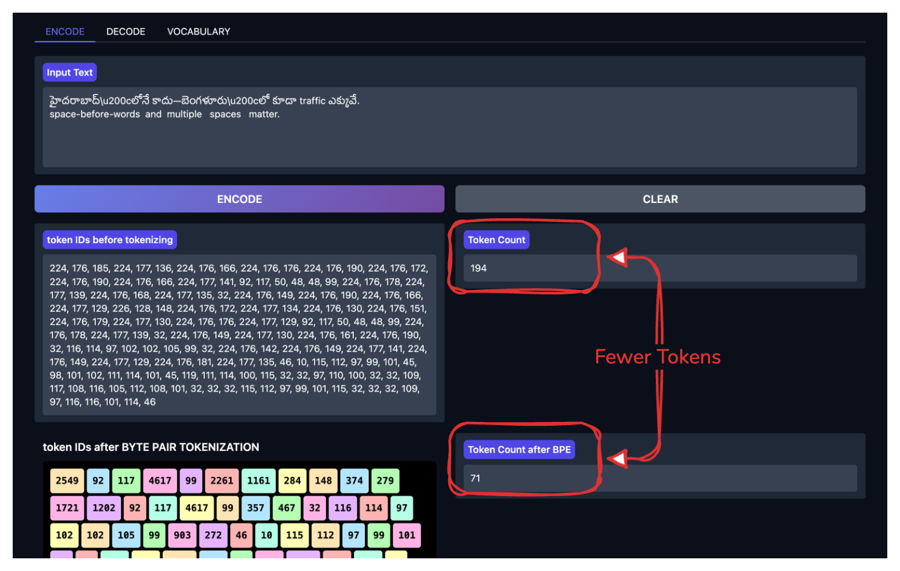
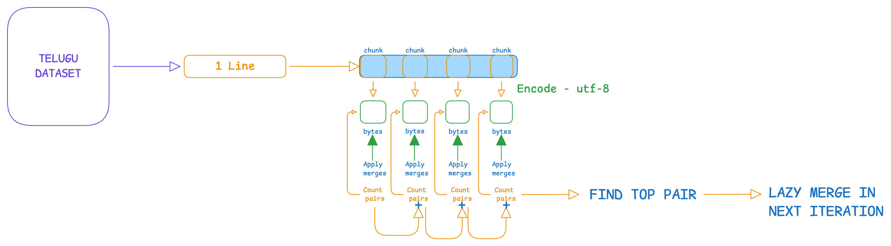
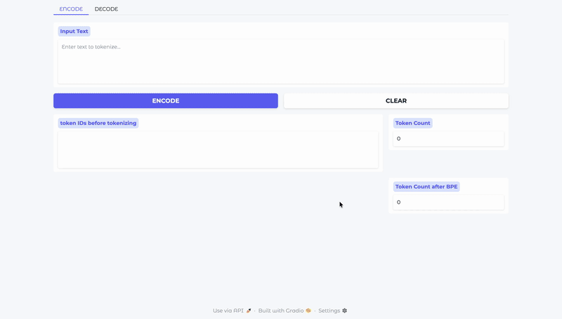

### Byte-Level BPE Tokenizer for Telugu

*Building a fully reversible tokenizer from scratch*

Tokenization is one of the most underestimated components of modern NLP systems. While models often get the spotlight, the tokenizer quietly determines **how text is represented, compressed, and ultimately understood** by the model.

Most production tokenizers are designed around English or Latin scripts. Indic languages like Telugu introduce a very different set of challenges:

* Multi-byte UTF-8 characters
* Combining marks and joiners (ZWJ / ZWNJ)
* Mixed scripts (Telugu + English + numbers)
* Emojis, URLs, emails, punctuation, and real-world noise

In this post, I walk through how I built a **byte-level Byte Pair Encoding (BPE) tokenizer for Telugu**, completely from scratch—without relying on HuggingFace tokenizers or SentencePiece internals.

By the end, you’ll see:

* How byte-level BPE actually works
* Why it completely avoids `<UNK>` tokens
* How to train it efficiently on large corpora
* How to measure compression quality
* How to visualize tokenization step-by-step in a web UI

---

## Why Byte-Level Tokenization?

Traditional word-level and subword tokenizers struggle with unseen words and complex Unicode text. Byte-level BPE solves this problem at its root.

### Core idea

* Start from **raw UTF-8 bytes** (values 0–255)
* Learn merges on byte pairs
* Build larger tokens incrementally
* Guarantee **full reversibility**

This design ensures:

* No `<UNK>` tokens
* Lossless decoding
* Robust handling of *any* Unicode text

> This is the same foundational idea used by GPT-2’s tokenizer.

---

## Pre-Tokenization: Unicode-Aware Chunking

Before applying BPE merges, raw text must be split into **meaningful chunks**. This is *not* word splitting — it is **regex-based segmentation** that preserves linguistic and structural boundaries.

### Goals of pre-tokenization

* Keep Telugu grapheme clusters intact
* Preserve join controls (`\u200c`, `\u200d`)
* Support Devanagari, Latin, numbers, and emojis
* Treat punctuation and whitespace as meaningful signals

I used the `regex` module (instead of Python’s built-in `re`) because it supports Unicode properties such as `\p{Script_Extensions=Telugu}`.


This ensures Telugu characters and combining marks are handled correctly *before* byte encoding begins.

---

## Byte Encoding: The True Base Vocabulary

Once chunks are identified, each chunk is converted into raw UTF-8 bytes:

```python
def chunkbytes(self, text: str):
    for chunk in self.pattern.findall(text):
        if not chunk:
            continue
        yield list(chunk.encode("utf-8"))
```

This has several important consequences:

* Initial vocabulary size = **256**
* Each byte is a valid token
* *All* text is representable

This step answers a fundamental question:

> *“How large is the text before any tokenization?”*

It also establishes the baseline for measuring compression.



---

## Training Byte Pair Encoding (BPE)

### How BPE works

1. Count adjacent token pairs
2. Identify the most frequent pair
3. Merge it into a new token
4. Repeat until the vocabulary size is reached

In my implementation:

* Merges are learned **incrementally**
* Vocabulary grows from `256 → VOCABSIZE`
* Each merge introduces a new token ID

```python
def tokenize(self, corpus_path: str, num_merges, maxlines, reportevery):
    for n in range(num_merges):
        stats = Counter()
        for line in readlines(corpus_path, maxlines):
            for chunk_token in self.chunkbytes(line):
                chunk_token = self.applymerges(chunk_token)
                stats.update(zip(chunk_token, chunk_token[1:]))

        if not stats:
            break

        top_pair = stats.most_common(1)[0][0]
        idx = 256 + len(self.merges)
        self.merges[top_pair] = idx
        self.vocab[idx] = self.vocab[top_pair[0]] + self.vocab[top_pair[1]]

        if (n + 1) % reportevery == 0 or n == 0:
            print(f"merge {n+1}/{num_merges} best={top_pair} id={idx}")
```

---

### Streaming Training (No RAM Explosion)

Instead of loading the entire dataset into memory:

* The corpus is streamed line-by-line
* Existing merges are applied lazily
* Pair counts are accumulated on the fly

This allows training on **gigabytes of text** with minimal memory usage.



---

## Dataset: IndicCorpV2 (AI4Bharat)

For training, I used the **Telugu subset of IndicCorpV2**, released by AI4Bharat.

* Large-scale, high-quality Indic corpus
* Covers real-world Telugu usage
* Includes mixed scripts and domains

I trained on a **1GB slice** for experimentation and scalability testing.

---

## Caching for Fast Encoding

Applying BPE merges repeatedly can be computationally expensive.

To optimize encoding speed, I implemented an **LRU cache**:

* **Key:** raw byte sequence
* **Value:** merged token sequence
* **Capacity-bounded** for memory safety

This dramatically speeds up repeated encodings, especially in interactive UI usage.

---

## Encoding and Decoding (Fully Reversible)

### Encoding pipeline

* Pre-tokenize text
* Convert chunks to bytes
* Apply BPE merges
* Return token IDs

### Decoding pipeline

* Map token IDs back to byte sequences
* Concatenate bytes
* Decode UTF-8

```python
decoded = b"".join(self.vocab[id] for id in tokens).decode("utf-8")
```

This guarantees:

> `decode(encode(text)) == text` — **always**

---

## Measuring Compression Ratio

To evaluate tokenizer quality, I computed:

```
compression_ratio = total_bytes / total_tokens
```

After training:

### **Compression Ratio ≈ 6.0**

This means:

* ~6 UTF-8 bytes per token on average
* Strong subword structure learning
* Effective merges for Telugu text

---

## Visualization: Making Tokenization Explainable

Tokenizers are often treated as black boxes.

I built a **Gradio-based interactive visualizer**, deployed on **HuggingFace Spaces**, that makes each step explicit.

### Visualizer features

* Raw byte IDs before tokenization
* Token IDs after BPE
* Color-coded token spans (1 color = 1 token)
* Hover-linked token ↔ token ID highlighting
* Decoding verification
* Merge trace preview

Each visual token corresponds **exactly** to one BPE token ID.



---

## Try It Yourself

* 🔗 **Live Demo (HuggingFace Spaces)**
  [https://huggingface.co/spaces/UXK005/telugu-bpe-tokenizer](https://huggingface.co/spaces/UXK005/telugu-bpe-tokenizer)

* 📦 **Source Code (GitHub)**
  [https://github.com/UXK005/indic-morph-tokenizer](https://github.com/UXK005/indic-morph-tokenizer)

* 📄 **Dataset**
  AI4Bharat IndicCorpV2 (Telugu)

---

## Final Thoughts

Building a tokenizer from scratch provides deep insight into how modern NLP systems truly work. A byte-level approach ensures robustness across scripts, languages, and noisy real-world text—making it especially well-suited for Indic languages.

If you’re building multilingual NLP systems or working with complex Unicode text, understanding tokenization at this level is not optional — it’s foundational.