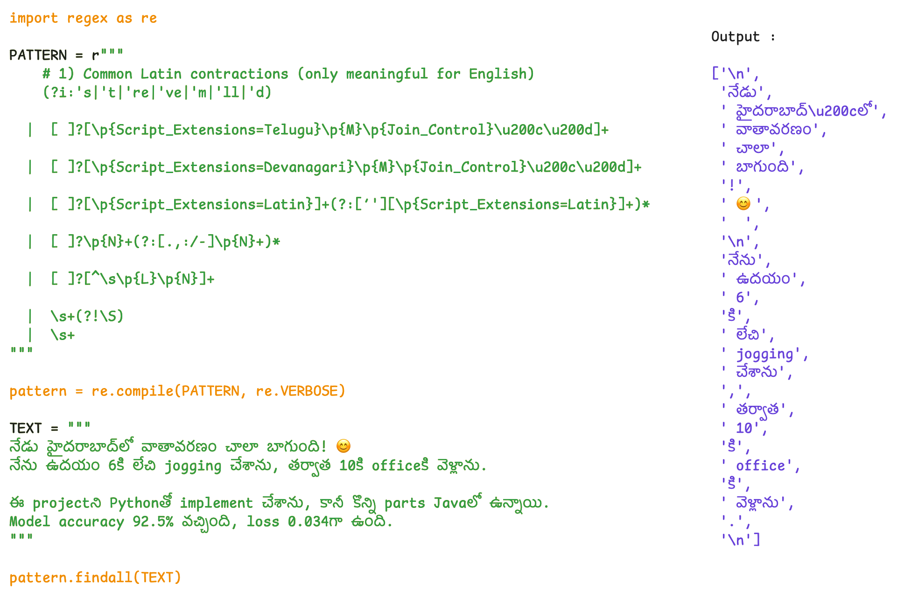

Tokenization is one of the most underestimated components of modern NLP systems. While models often get the spotlight, the tokenizer silently determines **how text is represented, compressed, and understood** by the model.

Most production tokenizers are designed around English or Latin scripts. Indic languages like Telugu present unique challenges:

* Multi-byte UTF-8 characters
* Combining marks and joiners (ZWJ / ZWNJ)
* Mixed scripts (Telugu + English + numbers)
* Emojis, URLs, emails, punctuation, and noise

In this post, I walk through how I built a **byte-level Byte Pair Encoding (BPE) tokenizer for Telugu**, completely from scratch—without relying on HuggingFace tokenizers or SentencePiece internals.

By the end, you'll see:

* How byte-level BPE works
* Why it avoids UNK tokens
* How to train it on large corpora efficiently
* How to analyze compression
* How to visualize tokenization step-by-step in a web UI

---

## Why Byte-Level Tokenization?

Traditional word-level or subword tokenizers struggle with unseen words and complex Unicode text. Byte-level BPE solves this elegantly.

### Key idea

* Start with **raw UTF-8 bytes** (0–255)
* Learn merges on byte pairs
* Build larger tokens progressively
* Guarantee **full reversibility**

This ensures:

* No `<UNK>` tokens
* Lossless decoding
* Robust handling of any Unicode text

> This is the same foundational idea used by GPT-2's tokenizer.

---

## Pre-Tokenization: Unicode-Aware Chunking

Before applying BPE merges, raw text must be split into *meaningful chunks*. This is not word splitting — it's **regex-based segmentation** that preserves structure.

### Goals of pre-tokenization

* Keep Telugu grapheme clusters intact
* Preserve join controls (`\u200c`, `\u200d`)
* Support Devanagari, Latin, numbers, emojis
* Keep punctuation and whitespace meaningful

I used the `regex` module (not Python's `re`) because it supports Unicode properties like `\p{Script_Extensions=Telugu}`.



This ensures Telugu characters and combining marks are treated correctly.

---

## Byte Encoding: The True Base Vocabulary

Once chunks are identified, each chunk is converted to raw UTF-8 bytes:

```python
def chunkbytes(self, text: str):
        for chunk in self.pattern.findall(text):
            if not chunk:
                continue
            yield list(chunk.encode("utf-8"))
```

This means:

* Initial vocabulary size = **256**
* Each byte is a valid token
* All text is representable

This step answers a critical question:

> *"How big is the text before tokenization?"*

And becomes the baseline for measuring compression.


---

## Training Byte Pair Encoding (BPE)

### How BPE Works

1. Count adjacent token pairs
2. Find the most frequent pair
3. Merge it into a new token
4. Repeat until vocab size is reached

In my implementation:

* Merges are learned **incrementally**
* Vocabulary grows from 256 → `VOCABSIZE`
* Each merge creates a new token ID

```python
def tokenize(self, corpus_path: str, num_merges, maxlines, reportevery):
        for n in range(num_merges):
            stats = Counter()
            for line in readlines(corpus_path, maxlines):
                for chunk_token in self.chunkbytes(line):
                    chunk_token = self.applymerges(chunk_token)
                    stats.update(zip(chunk_token, chunk_token[1:]))
            if not stats: break
            top_pair = stats.most_common(1)[0][0]
            idx = 256 + len(self.merges)
            self.merges[top_pair] = idx
            self.vocab[idx] = self.vocab[top_pair[0]] + self.vocab[top_pair[1]]

            if (n+1) % reportevery == 0 or n == 0:
                print(f"merge {n+1}/{num_merges} best={top_pair} id={idx}")
```

### Streaming Training (No RAM Explosion)

Instead of loading the entire dataset:

* I stream the corpus line-by-line
* Apply existing merges
* Count pairs on the fly

This allows training on **gigabytes of text** with minimal memory.


---

## Dataset: IndicCorpV2 (AI4Bharat)

For training, I used the **Telugu subset of IndicCorpV2**, released by AI4Bharat.

* Large-scale, high-quality Indic corpus
* Covers real-world Telugu usage
* Mixed scripts and domains

I trained on a **1GB slice** for experimentation and scaling.

---

## Caching for Fast Encoding

BPE encoding can be expensive because merges are applied repeatedly.

To optimize this, I implemented an **LRU cache**:

* Key: raw byte sequence
* Value: merged token sequence
* Capacity-bounded for memory safety

This dramatically speeds up repeated encodings (especially in UI use).

---

## Encoding and Decoding (Fully Reversible)

### Encoding

* Pre-tokenize text
* Convert to bytes
* Apply BPE merges
* Return token IDs

### Decoding

* Map token IDs back to byte sequences
* Concatenate bytes
* Decode UTF-8

```python
decoded = b"".join(self.vocab[id] for id in tokens).decode("utf-8")
```

This guarantees: `decode(encode(text)) == text` **Always**.

---

## Measuring Compression Ratio

To evaluate tokenizer quality, I computed:

```
compression_ratio = total_bytes / total_tokens
```

After training: **Compression Ratio ≈ 6.0**

This means:

* 6 UTF-8 bytes per token on average
* Strong subword learning
* Effective merges for Telugu

---

## Visualization: Making Tokenization Explainable

Tokenizers are often black boxes.

I built a **Gradio-based interactive visualizer**, deployed on **HuggingFace Spaces**, that shows:

### Features

* Byte IDs before tokenization
* Token IDs after BPE
* Color-coded tokens (1 color = 1 token ID)
* Hover-linked token ↔ token ID
* Decoding verification
* Merge trace preview

Each visual token corresponds **exactly** to one BPE token ID.


---

## Key Takeaways

This project demonstrates:

* Deep understanding of Unicode & UTF-8
* Tokenization internals beyond libraries
* Efficient large-scale training
* Explainable NLP tooling
* End-to-end system thinking

It's not just a tokenizer — it's a **learning artifact**.

---

## Try It Yourself

* 🔗 **Live Demo (HuggingFace Spaces)**  
  *(link here)*

* 📦 **Source Code (GitHub)**  
  *(link here)*

* 📄 **Dataset**  
  AI4Bharat IndicCorpV2 (Telugu)

---

## Final Thoughts

Building a tokenizer from scratch provides invaluable insights into how modern NLP systems actually work. The byte-level approach ensures robustness across languages and scripts, making it ideal for multilingual applications.

For anyone working with Indic languages or building production NLP systems, understanding tokenization at this level is essential.
